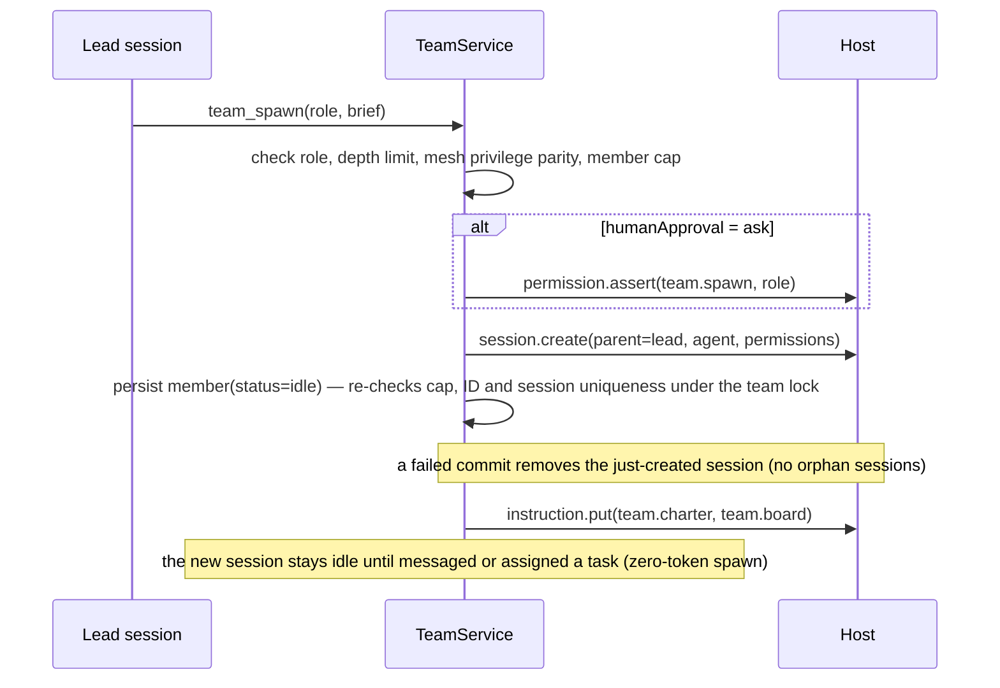

# Team Mode design

OpenCode V2 plugin `team-mode`, package `opencode-team-mode`. Milestone 1 covers
one active team per project, a hub topology, durable mailboxes, a shared task
board, file leases, budgets and crash recovery. Worktree isolation and the TUI
panel are later phases.

## Layers

```
tools/hooks/commands  ──►  TeamService (orchestration)
                                 │
              ┌──────────────────┼──────────────────┐
              ▼                  ▼                  ▼
          Mailbox              Board              Limits
              └──────────────────┼──────────────────┘
                                 ▼
                              TeamStore  ──►  Host (src/host.ts)  ──►  ctx.*
                                 │
                              pure core (render, roles, ids, config)
```

`src/host.ts` is the only module that touches `ctx`. `FakeHost` implements the
same interface in tests.

## Data and identity

- Team `tm_<ulid>`; member slug (`implementer-1`, `lead`); task `t_<n>`; envelope `env_<ulid>`.
- Storage: `team/<teamID>/meta`, `.../members/<id>`, `.../tasks/<id>`,
  `.../inbox/<memberID>/env_<ulid>`, `.../log/<ulid>` (audit-only, never loaded
  into transactions); mutable coordination state lives under aux keys:
  `.../aux/pairs.<a>__<b>`, `.../aux/wait.<memberID>`, `.../aux/rate.<memberID>`;
  global `session/<sessionID>` → `{teamID, memberID}`.
- `from` is resolved from the tool's `context.sessionID` through the persisted
  session index. Tools accept no `from` field.
- Version counters on team, member and task records. All mutations run through a
  per-team async mutex; envelopes are written before delivery, delivery is
  at-least-once and deduped by envelope id. A failed flush rolls dirty keys
  back to the transaction's baseline snapshot (best effort).

## Roles

OpenCode cannot register agents (S2). A role is:

1. an existing agent (`build` by default, or a configured one), passed directly
   to `session.create({ agent })` — no `switchAgent` needed,
2. a keyed `team.charter` instruction entry (role duties + team goal + limits),
3. session permission rules that only add `deny` entries (never weaken an
   explicit deny).

Presets: `lead`, `architect`, `implementer`, `reviewer`, `researcher`.

## Spawn



## Send and deliver

```mermaid
sequenceDiagram
  participant A as Member A
  participant S as TeamService
  participant D as Store
  participant B as Member B
  A->>S: team_send(to, subject, body)
  S->>S: resolve from = A, rate/hop/dedupe checks
  S->>D: write envelope to B's inbox (durable)
  alt B idle
    S->>B: session.synthetic(rendered, queue)
    S->>D: mark delivered
  else B busy, urgent
    S->>B: session.synthetic(rendered, steer)
    S->>D: mark delivered
  else B busy, normal
    S->>D: keep unread; refresh team.board "N unread"
  end
  B->>S: team_inbox
  S->>D: mark read, return full bodies
```

## Claim and handoff

```mermaid
sequenceDiagram
  participant A as Claimant A
  participant S as TeamService
  participant D as Board store
  participant L as Lead
  A->>S: team_task_claim(t_7, paths)
  S->>D: lock team; read task
  alt task owned or dependency open or path leased
    S-->>A: Tool.Error with owner / dependency / lease
  else free
    S->>D: owner=A, status=claimed, paths, version+1
    S-->>A: claimed
  end
  A->>S: team_handoff(to=B, t_7, summary)
  S->>D: owner=B, status=claimed, handoffFrom=A
  S->>D: envelope(type=handoff, correlation)
  S->>B: deliver according to state
  S->>L: status note
```

## Stop

```mermaid
sequenceDiagram
  participant L as Lead
  participant S as TeamService
  participant H as Host
  L->>S: team_stop(member?|all)
  S->>S: member.status=stopped (or team.status=stopped), release owned tasks
  S->>H: session.interrupt(resume=false) — every session except the caller
  S->>H: instruction.put(team.board) — board reflects released tasks
  S->>S: keep records for audit; sessions are never deleted
  Note over S,H: unload never stops sessions; only an explicit stop does
```

## Limits

- members incl. lead, depth limit, hops per thread, per-member sends/minute,
  duplicate suppression, ping-pong detector (N exchanges, no task change →
  pause pair + notify lead; any board change releases the pair immediately),
  turns per member, wall clock per member and team, envelope TTL, board size cap.
- Per-member budgets (turns, wall clock) are checked lazily on tool calls and on
  a timer sweep. A violating member is interrupted and marked `stopped`, and its
  tasks are released back to `pending`. The team-cost budget is evaluated once
  per sweep: exceeding it pauses the whole team (`status=paused` with a reason)
  instead of stopping members one by one.
- `team_wait` is lead-only (unless `peerWait`) and consults a persisted wait
  graph before blocking; a cycle rejects the wait with the full path.

## Recovery

`setup` scans `team/*/meta`. For each active team: `session.get` the lead and
every member; orphaned `wait.*` edges are purged and members frozen in
`blocked` are reset to `idle`; missing member sessions are marked `stopped` with
their tasks released; the session index is rebuilt; instruction entries
(charter and board) are refreshed; undelivered envelopes are re-delivered. If
the lead session is gone, the team is marked `stopped`.
`cleanup` aborts subscriptions, clears timers and disposes registrations but
leaves sessions and team state intact.

## Known risks

- Storage has no CAS; the mutex is per process. Multiple plugin instances on the
  same project can produce last-write-wins races. Writes are idempotent and the
  design treats storage as the source of truth on recovery.
- `instructions.entry` is experimental and keys must match
  `^[a-z0-9][a-z0-9._-]*$`.
- Peer wakes use `session.synthetic`, which starts a model turn (S3). A burst of
  sends can therefore cost tokens; rate limits and the "N unread" batching rule
  are part of the safety model.
- `ctx.agent.list()` returns `{ data }`, not an array.
